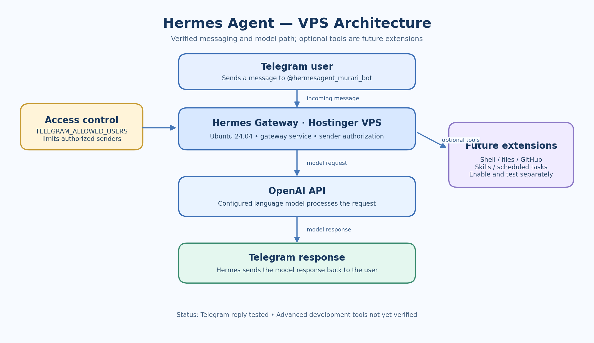

# Hermes Agent VPS Assistant

A self-hosted Hermes Agent gateway running on an Ubuntu Hostinger VPS, connected to Telegram and the OpenAI API.

> **Project status:** Telegram messaging and OpenAI responses have been tested successfully. Advanced development tools, repository access, scheduled automation, and other integrations remain future validation tasks.

## Current capabilities

- Hermes Agent v0.22.5 installed on an Ubuntu 24.04 VPS.
- Hermes gateway running as a systemd user service.
- Telegram bot: `@hermesagent_murari_bot`.
- OpenAI API configured as the model provider.
- Telegram user access restricted through `TELEGRAM_ALLOWED_USERS`.
- A test message sent through Telegram received a successful reply.

## Architecture

See [Architecture](docs/architecture.md) for the component overview and request flow.

## Documentation

- [Architecture](docs/architecture.md) — components, request flow, and current boundaries.
- [Deployment and operations](docs/deployment.md) — installation state, verification, and troubleshooting.
- [Security](docs/security.md) — credentials, Telegram authorization, and safe operation.
- [Development roadmap](docs/development-roadmap.md) — planned developer-assistant capabilities and validation checklist.

## Current setup summary

| Component | Current state |
|---|---|
| Host | Hostinger VPS |
| Operating system | Ubuntu 24.04 |
| Hermes Agent | v0.22.5 |
| Gateway service | Running as a systemd user service |
| Messaging | Telegram bot responding |
| Model provider | OpenAI API configured and tested |
| Telegram authorization | User ID allowlisted in `~/.hermes/.env` |
| Developer tools and repository access | Not yet verified |

## Safety notes

- Never commit `.env`, API keys, Telegram bot tokens, or private logs.
- Keep Telegram access restricted to intended user IDs.
- Enable additional tools only after reviewing their permissions and effects.
- Do not claim that a capability is available until it has been tested on this installation.

## Next milestones

1. Verify the installed Hermes tools and enabled toolsets.
2. Test a development-oriented task through Telegram.
3. Validate any file, shell, Git, or repository integrations separately.
4. Configure scheduled tasks only after confirming the scheduler and delivery path.
5. Record tested commands and outcomes in the documentation.

## License

A license has not been selected yet. Add a license before publishing if you want others to reuse this project's content.
