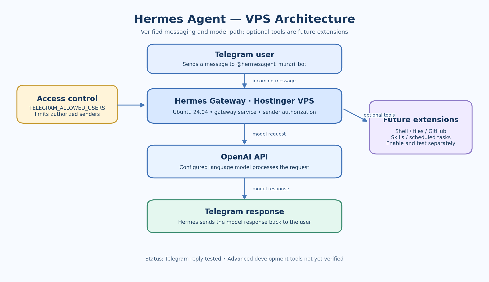

# Architecture

## Overview

This project connects a Telegram user to a Hermes Agent gateway hosted on an Ubuntu VPS. The gateway routes messages to the configured model provider and returns the response to Telegram.

## Request flow

1. The user sends a message to `@hermesagent_murari_bot`.
2. The Telegram integration receives the message.
3. Hermes checks whether the sender is authorized.
4. The gateway passes the request to the configured OpenAI model.
5. Hermes receives the model response and sends it back through Telegram.

## Components

| Component | Responsibility | Status |
|---|---|---|
| Telegram client and bot | User-facing messaging channel | Tested |
| Hermes gateway | Receives and routes messages | Running |
| Telegram allowlist | Restricts which Telegram user IDs may access the bot | Configured |
| OpenAI API | Language-model inference | Test response received |
| Optional tools and integrations | Extend the agent with development actions | Not yet verified |

## Important boundary

A successful Telegram response proves the messaging and model path works. It does **not** by itself prove that Hermes can access a local PC, GitHub repositories, VPS project files, or scheduled automation. Validate each additional tool separately before relying on it.
